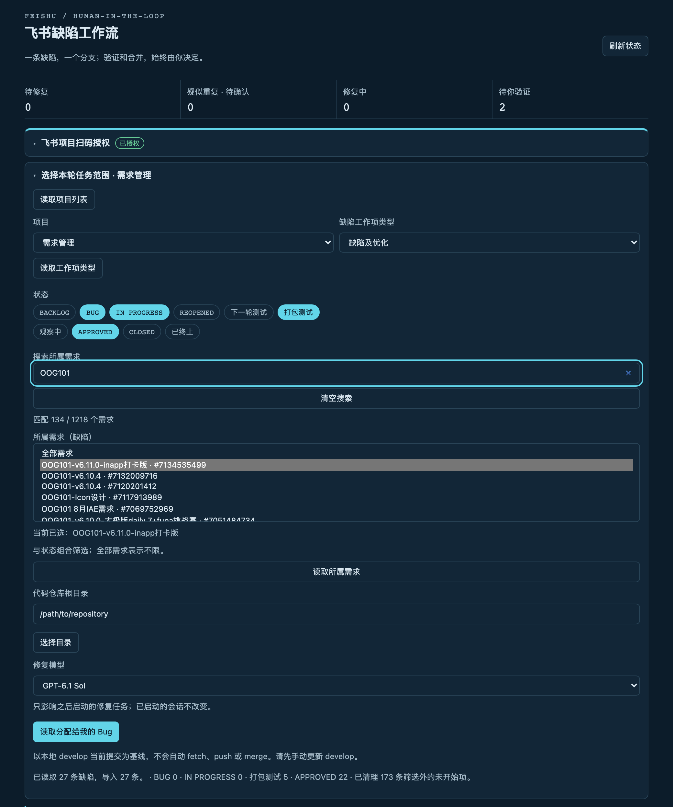

# 飞书缺陷工作流 · DSH 插件

在 DeepSeek Harness（DSH）Web GUI 里读取飞书项目（Feishu Project / Meegle）中**分配给我**的缺陷，逐条在独立 worktree / 分支里修复，并把「重复确认、验收、合并」留在人手里。

一条缺陷 = 一个分支 = 一个可审查的执行会话；插件从不提交、推送或合并。

> A DSH bundle that turns your Feishu Project bug queue into isolated, review-gated repair branches. Human-only duplicate decisions, verification, and merging.

## 它解决什么

- 飞书项目里几十上百条 bug，人工挑选、拉分支、写上下文很碎。
- 希望每个 bug 独立分支、互不污染，修完由人验证。
- 重复缺陷不该重复开分支，但机器判断不可靠，需要人先确认。

## 界面

真实运行截图（本地仓库路径已打码）：



顶部是四个门禁计数：待修复、疑似重复待确认、修复中、待你验证。下面依次是扫码授权、本轮范围（项目 / 工作项类型 / 状态筛选 / 仓库目录）与缺陷列表。

## 工作流

1. **扫码授权**：面板生成官方 Meegle Device Code 二维码，用飞书扫码并在官方页面确认。插件不接触令牌，令牌由官方 CLI 存入系统钥匙串。
2. **读取范围**：选项目 → 选工作项类型（缺陷）→ 按工作流状态筛选（默认 `BUG,REOPENED`）→ 选本地仓库根目录 → 读取分配给我的未完成缺陷。
3. **重复确认**：标题相似度 ≥ 0.72 的条目标为「疑似重复 · 待确认」。确认重复 → 跳过、不开分支；确认不重复 → 才允许开始。
4. **独立修复**：每个 bug 在当前本地 `develop` 的最新提交上创建 `fix/feishu-<bug编号>[-标题片段]` 分支和独立 worktree；缺陷截图会先落到 worktree，再交给 DSH 任务面板执行修复会话。
5. **人工验收**：agent 在修复分支上提交（不推送、不合并），面板显示提交号。若历史修复还停在“只改工作树”，面板会显示未提交条数并提供「提交 worktree 改动」；点「在主仓检出该分支」即可在带 Pods 的主仓直接构建运行；主仓有未提交改动时会拒绝切换。不通过可写反馈重试；通过只标记「待手动合并」，并把该 bug 的 workspace 从侧栏移除（worktree、分支与日志保留），之后可用「主仓切回 develop」收尾。
6. **你来合并**：提交、推送、合并 `develop` 始终由你在自己的终端完成。

## 支持版本

| 组件 | 支持范围 | 本次验证 |
| --- | --- | --- |
| DeepSeek Harness | `>= 0.2.1-rc.2`（`dsh.engines.dsh`） | 0.2.1-rc.2（macOS） |
| 面板运行环境 | DSH Web GUI（`dsh web`） | 当前桌面版 |
| Node.js（随 DSH 提供） | `>= 22` | 25.2.0 |
| 官方 Meegle CLI | 固定 `@lark-project/meegle@1.0.27` | 1.0.27 |
| 必需 DSH 扩展 | 任务面板插件（提供 `taskBoard` / `workspaceRegistry`） | 0.4.8 |
| 操作系统 | 需要系统钥匙串与 git | macOS |

**支持策略**

- `1.1.x` 为当前支持版本，修复以补丁版本发布（当前 `1.2.1`）。
- DSH 或 Meegle CLI 出现破坏性变更时，发布新的次版本并在 [CHANGELOG.md](CHANGELOG.md) 标注兼容范围。
- 低于 `0.2.1-rc.2` 的 DSH 不受支持；缺少任务面板插件时面板会加载失败，而不是降级执行。
- 仅支持单用户本机使用：Host 必须运行，面板跟随 owner 浏览器身份。

## 安装

前置：DSH `>= 0.2.1-rc.2`，已安装并启用 DSH 任务面板插件（`@linxin666/dsh-client-ui-task-board`）。

```sh
git clone https://github.com/PetterWong-L/dsh-feishu-bugs.git
cd dsh-feishu-bugs
npm install --omit=dev
```

在 DSH 中把这个目录作为 bundle 安装（插件管理里选择该目录的绝对路径），然后重启 DSH。侧栏会出现「飞书缺陷工作流」。

数据默认写入 `~/.dsh/feishu-bugs-data`；如需自定义，在 bundle 配置里设置绝对路径 `storageDir`。

升级：拉取新版本后重启 DSH。执行状态、分支与选择都会持久化，重启不会重放分支创建。0.x 版本把数据放在 `~/dsh/feishu-bugs-data`，1.0 会一次性接管该目录，不会显示成空队列。

卸载：在插件管理里禁用/移除该 bundle；数据目录不会自动删除。

## 安全模型

- 授权使用官方 CLI 的专用 profile `dsh-feishu-bugs` 与固定 host `project.feishu.cn`，不继承其他飞书 CLI 登录或环境令牌。
- 访问令牌只存在系统钥匙串；插件、浏览器、模型都不读取或转存。
- 面板 HTTP/SSE 使用 Harness 的 owner 连接鉴权；POST 额外校验同源、JSON 与大小。模型侧只有只读状态工具，无法启动授权、确认重复、验收或执行。
- CLI 通过 `execFile` 固定参数调用，不经 shell；原始错误不返回给浏览器。
- Bug 正文与截图按**不可信数据**处理；提示词禁止合并、推送、跨仓库修改和读取凭据，并要求图片只当证据、不得提交。
- 附件只下载 `project.feishu.cn` 签名地址上的图片（PNG/JPEG/GIF/WebP/HEIC），最多 5 张、单张 20MB；文件名重写为安全名，写入 `.feishu-attachments/`，不执行。
- 这不是针对本机恶意进程的沙箱；组织级保护请对 `develop` 设置分支保护。

## 边界与已知限制

- 重复检测只做标题文本相似度，不能替代语义判断。
- 一次只运行一个修复会话；队列在重启后需手动继续。
- 侧栏只保留仍在进行中的修复工作区；验收通过后工作区注册被删除，目录不会删。
- 检出分支只在主仓工作树干净时执行；不会替你提交、推送或合并。
- 无飞书消息推送、系统通知、定时同步或 webhook。
- 单次最多导入最近更新的 200 条缺陷（面板会提示截断）。
- 构建验证优先使用已连接的 Xcode MCP（`mcp__xcode__*`），未连接时才退回 `xcrun xcodebuild`；任务总结会注明走了哪条路径。
- 修复质量取决于 DSH 会话；完成不等于修好，必须人工验收。
- 只读取附件字段里的图片，不解析富文本正文中的内联图片；非图片附件（日志、录屏）不会下载。
- 截图下载失败不会卡住修复，但会把失败原因写进提示词，代理需显式说明缺图。
- 读取、筛选、分支、截图下载与面板状态流转已用真实账号验证；真实缺陷的修复闭环建议先小范围试用。

## 开发

```sh
npm install
npm test          # node --test *.test.js
node --check client.js
node --check index.js
```

| 文件 | 职责 |
| --- | --- |
| `index.js` | Host 扩展：动作、状态机、任务启动、HTTP/SSE 路由 |
| `client.js` | 侧栏与主面板 UI（React，经 DSH 插槽挂载） |
| `meegle.js` / `mql.js` | 官方 CLI 调用、MQL 查询、分页与 typed 字段解码 |
| `auth.js` / `cli.js` | Device Code 授权、CLI 执行封装 |
| `git.js` | 分支/worktree 创建与校验 |
| `workflow.js` / `store.js` | 人工门禁状态机与持久化 |
| `http.js` | owner 鉴权路由 |

## 版本记录

见 [CHANGELOG.md](CHANGELOG.md)。

## License

[MIT](LICENSE)
